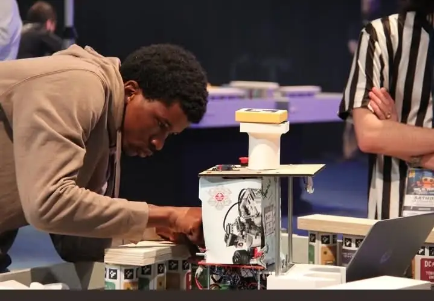
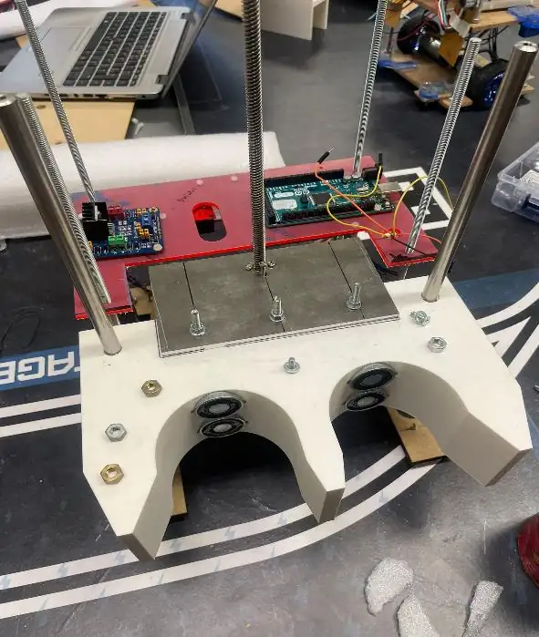
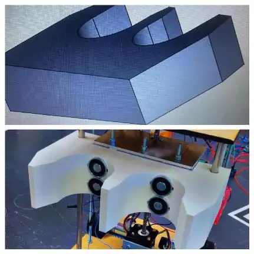
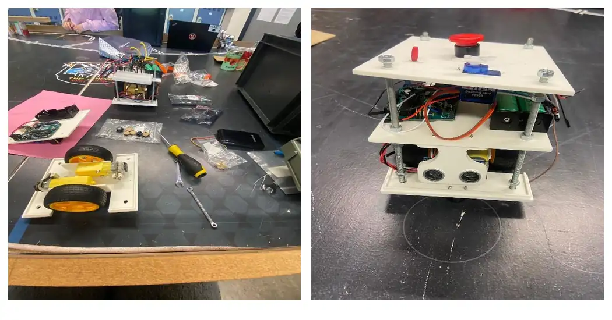

# Robot autonome & PAMIs — Coupe de France de Robotique 2025

**De la conception mécanique au robot sur le terrain : motorisation, électronique, asservissement et C++ embarqué.**



*Réglages du robot sur le terrain, avant une manche de compétition.*

## Le projet

Pour la **Coupe de France de Robotique 2025 — « Robot Rock Tour »**, nous avons conçu et réalisé, en **équipe de six étudiants**, un **robot principal autonome** accompagné de **PAMIs** (Petits Actionneurs Mobiles Indépendants), sous les couleurs du **CRIG1, club de robotique de l'Institut Galilée**.

**Le défi :** créer un ensemble de robots capables d'effectuer des actions sur un terrain de compétition, sans intervention humaine pendant le match : **déployer une banderole, construire des gradins, se déplacer vers les zones de jeu et participer au spectacle final avec les PAMIs**.

Pour y parvenir, nous avons dû réunir **conception mécanique, choix des moteurs, électronique, programmation embarquée, automatique et essais sur le terrain**. C'est cette intégration, du premier dimensionnement jusqu'aux réglages avant match, qui fait l'intérêt du projet.

## De la conception au prototype

### 1. Concevoir la base roulante et choisir la motorisation

Pour le robot principal, nous avons retenu une **base différentielle à deux roues motrices et quatre roues folles**. Il fallait obtenir un robot **stable, maniable et assez compact** pour respecter les contraintes du terrain, tout en portant les batteries, les capteurs et les mécanismes de jeu.

J'ai participé à **l'étude des architectures de bases roulantes, au dimensionnement, au choix des motoréducteurs et à la conception du robot principal**. Le travail a inclus le calcul des besoins de déplacement et de couple, puis l'intégration des **moteurs DC 12 V avec encodeurs**, de la commande par pont en H et du châssis modélisé sous **FreeCAD**.

| Robot principal en cours d'assemblage | Mécanisme pour les gradins |
| :---: | :---: |
|  |  |

### 2. Développer le contrôle du robot en C++

L'un des principaux problèmes techniques était de **faire avancer le robot sur la bonne distance et limiter les écarts de trajectoire**, malgré les différences entre les deux moteurs.

Dans le firmware Arduino, la solution repose sur une boucle de contrôle avec **retour des encodeurs et correction PID** :

```text
Consigne de déplacement
          ↓
Lecture des encodeurs par interruptions
          ↓
Calcul de la distance de chaque roue
          ↓
Écart entre les deux roues → correction PID
          ↓
Ajustement du PWM moteur → déplacement
```

Le code de [`Moteurs.cpp`](Software/Moteurs.cpp) met notamment en œuvre **`attachInterrupt()`**, des compteurs **`volatile`**, les calculs de distance et les commandes **PWM**. Les paramètres matériels et les gains du régulateur sont regroupés dans [`Config.h`](Software/Config.h).

L'architecture est organisée en modules C++ pour distinguer **la locomotion, les capteurs, les actionneurs et la stratégie de match**.

**[Voir le code de l'asservissement PID](Software/Moteurs.cpp)** · **[Voir le programme principal](Software/Programmation_robot.ino)**

### 3. Intégrer les capteurs et les mécanismes

Le robot ne devait pas seulement se déplacer : il devait aussi **agir sur son environnement**. Nous avons intégré plusieurs sous-systèmes :

- **Capteurs ultrasoniques HC-SR04** pour mesurer la distance aux obstacles ;
- **Servomoteurs** pour le mécanisme de la banderole ;
- **Électroaimants** pour saisir ou relâcher certains éléments de jeu ;
- **Séquences de déplacement** pour les gradins et les zones de mission ;
- **Écran TFT** pour l'affichage d'informations et du score estimé.

La logique de ces fonctions est répartie entre [`Capteurs.cpp`](Software/Capteurs.cpp), [`Servos.cpp`](Software/Servos.cpp), [`Electroaimant.cpp`](Software/Electroaimant.cpp), [`Gradin.cpp`](Software/Gradin.cpp) et [`TFT.cpp`](Software/TFT.cpp).

### 4. Concevoir et intégrer les PAMIs

Les **PAMIs** complétaient le robot principal lors des dernières actions du match. Ces petits robots mobiles ont été conçus autour d'une structure compacte intégrant **moteurs DC, carte Arduino, électronique de commande, alimentation autonome et capteurs**, avec un **servomoteur et une hélice** pour l'animation finale.

J'ai également participé au projet dans sa globalité, **y compris aux PAMIs, aux choix techniques et aux phases d'intégration et de tests**.



*Construction et intégration des PAMIs.*

## Mon implication

Ce projet m'a permis de participer à **toutes les grandes étapes de réalisation d'un système robotique**, au sein d'une équipe de six étudiants : **étude du cahier des charges, choix techniques, conception mécanique, motorisation, intégration électronique, programmation C++, réglages et essais en compétition**.

J'ai notamment travaillé sur la **base roulante du robot principal**, le **choix des moteurs**, l'**asservissement PID** et le **développement du programme embarqué**, tout en contribuant à l'intégration de l'ensemble, PAMIs compris.

Le défi était de faire fonctionner **un système complet**, et pas seulement d'écrire un programme : les choix mécaniques influencent les moteurs, les mesures des encodeurs influencent la commande, et les mécanismes doivent s'intégrer dans une stratégie de match.

## Code et technologies

| Module | Ce qu'il contient |
| --- | --- |
| [`Programmation_robot.ino`](Software/Programmation_robot.ino) | Initialisation et séquences du match |
| [`Moteurs.cpp`](Software/Moteurs.cpp) | Motorisation, encodeurs, interruptions et PID |
| [`Capteurs.cpp`](Software/Capteurs.cpp) | Mesures ultrasoniques |
| [`Gradin.cpp`](Software/Gradin.cpp) | Déplacements pour les actions de jeu |
| [`Servos.cpp`](Software/Servos.cpp) | Servomoteurs et banderole |
| [`Electroaimant.cpp`](Software/Electroaimant.cpp) | Commande des électroaimants |
| [`TFT.cpp`](Software/TFT.cpp) | Affichage sur écran TFT |
| [`Config.h`](Software/Config.h) | Configuration des broches, moteurs, géométrie et PID |

**Environnement :** Arduino / C++, FreeCAD, moteurs DC, encodeurs, PWM, PID_v1, HC-SR04, servomoteurs, électroaimants et écran TFT.

**État du dépôt :** le code publié concerne principalement le robot principal. Certaines parties de cette version demandent encore à être complétées ou intégrées, notamment le raccordement de la détection d'obstacles à la boucle de déplacement et une fonction de construction de gradin. Les sources spécifiques des PAMIs ne sont pas encore incluses.

---

**Coupe de France de Robotique 2025 · CRIG2 · Institut Galilée · Projet réalisé en équipe de six étudiants**  
**Amadou Oury Diallo — Instrumentation et systèmes embarqués**
