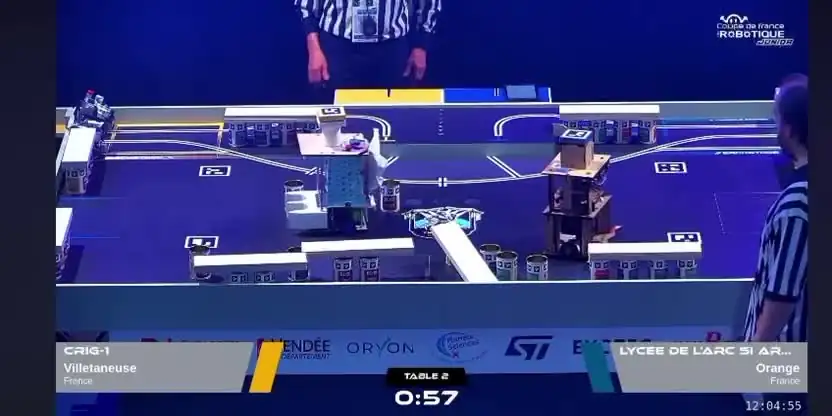
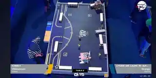

# Robot principal et PAMIs — Coupe de France de Robotique 2025

**Conception mécanique · Dimensionnement et motorisation · C++ embarqué · Arduino · PID et encodeurs · Électronique · Intégration et essais**

## Le projet : concevoir des robots pour une compétition

Dans le cadre de notre première année de cycle ingénieur à **l'Institut Galilée — Université Sorbonne Paris Nord**, nous avons travaillé à **six étudiants** sur un système robotique pour la **Coupe de France de Robotique 2025 (Eurobot, thème « Robot Rock Tour »)**.

Notre équipe représentait **CRIG2, le club de robotique de l'Institut Galilée** ; le club comptait également une autre équipe engagée dans cette aventure.

L'objectif était de **concevoir, fabriquer et programmer un robot principal autonome**, accompagné de **PAMIs** (*Petits Actionneurs Mobiles Indépendants*), pour réaliser des missions sur un terrain de jeu : **déployer une banderole, construire des gradins, positionner des robots sur la scène et rejoindre la zone d'arrivée**.

Ce n'était pas seulement un projet de programmation : il fallait partir d'un cahier des charges, **choisir une architecture mécanique, dimensionner les moteurs, intégrer l'électronique et les actionneurs, développer le logiciel embarqué**, puis tester et ajuster les robots dans les conditions de la compétition.

**[Voir le programme principal](Software/Programmation_robot.ino)** · **[Lire le code moteur/PID](Software/Moteurs.cpp)** · **[Explorer les modules embarqués](Software/)**

## Le projet en images

### Sur le terrain : réglages avant un match

*Réglages et vérifications du robot principal sur l'aire de compétition. Photo fournie pour ce portfolio.*

### Du dimensionnement à la réalisation

| Assemblage du robot principal | Actionneur pour la construction des gradins |
| :---: | :---: |
|  |  |
| Châssis, électronique, capteurs et mécanismes | Modélisation et intégration d'une pièce de mission |

### PAMIs : assemblage et prototype

*Deux vues issues du rapport final collectif : intégration des composants et PAMI assemblé.*

### Le robot pendant la compétition

| Vue du terrain | Court extrait animé du match |
| :---: | :---: |
|  |  |

*Images extraites de la séquence vidéo de compétition fournie pour le projet. L'aperçu animé dure environ quatre secondes et ne remplace pas la vidéo intégrale.*

**Origine des visuels :** rapport final de l'équipe (assemblage du robot : p. 10 ; mécanisme des gradins : p. 11 ; PAMIs : p. 17), photo de réglage avant match et vidéo de compétition fournies pour ce dépôt.

## Ma participation : de la conception aux essais en compétition

J'ai été impliqué dans **les différentes étapes de ce projet collectif**, pas uniquement dans le code. Mon travail a notamment porté sur :

- **L'étude et la conception du robot principal**, avec la comparaison des architectures de bases roulantes, le choix d'une base différentielle, les contraintes de stabilité, d'encombrement et d'implantation des composants ;
- **Le dimensionnement et le choix des moteurs**, en tenant compte de la masse, des dimensions des roues, de la vitesse recherchée, du couple nécessaire, des encodeurs, du pont en H et de l'alimentation ;
- **La conception et l'intégration matérielle** : modélisation avec FreeCAD, assemblage du châssis, implantation des capteurs, des actionneurs et de l'électronique ;
- **Le développement C++ embarqué** : pilotage des moteurs, lecture des encodeurs, correction PID, commandes des actionneurs et séquences de déplacement ;
- **Les PAMIs**, en participant à la réflexion et à l'intégration du système robotique complet, ainsi qu'aux échanges, réglages et essais avec l'équipe ;
- **La préparation de la compétition**, avec les ajustements, les vérifications et les réglages du robot avant les matchs.

Ce travail a été **réalisé en équipe de six** : les activités de conception, de fabrication et de tests étaient partagées. Le sous-groupe auquel je participais avec **Obed et Sokhna** s'est principalement occupé du **robot principal, de sa base roulante, de la propulsion et de la programmation**. Les PAMIs ont été principalement développés par **Soukayna, Hiba et Ndeye Fatou**, avec des échanges et une intégration à l'échelle de toute l'équipe.

J'ai également assuré une **période de coordination du projet (28 avril – 18 mai 2025)**, dédiée au suivi des améliorations après la revue des projets et à la préparation de la compétition.

## 1. Étude mécanique et choix de la motorisation

Pour que le robot principal puisse se déplacer et manipuler des éléments de jeu, nous avons retenu une **base roulante différentielle** : **deux roues motrices indépendantes** et **quatre roues folles**, sur un châssis pensé pour recevoir les batteries, les cartes électroniques et les mécanismes.

Le rapport de conception documente une étude préliminaire à partir des hypothèses suivantes :

| Paramètre de dimensionnement | Valeur étudiée |
| --- | ---: |
| Masse de référence du robot | **6 kg** |
| Diamètre des roues | **6,5 cm** |
| Vitesse de déplacement visée | **0,24 m/s** |
| Vitesse de rotation correspondante aux roues | **environ 70,5 tr/min** |
| Couple par roue estimé à partir de la seule résistance au roulement | **environ 14,3 mN·m** |
| Encombrement visé du châssis principal | **environ 25 × 25 cm** |

Cette étude simplifiée a servi de **point de départ au choix de la propulsion** ; elle ne remplace pas un dimensionnement complet prenant en compte l'accélération, les frottements réels, les pertes mécaniques et les marges de couple.

Le choix s'est orienté vers des **motoréducteurs à courant continu 12 V avec encodeurs**, un **driver de moteurs à pont en H** et une commande de vitesse par **PWM**. L'utilisation des encodeurs permet de mesurer le déplacement et de corriger la trajectoire.

La réalisation mécanique a mobilisé **FreeCAD**, un châssis en contreplaqué et des pièces fabriquées pour l'intégration des capteurs, de la banderole et des mécanismes de gradins.

## 2. Développement embarqué : déplacement et asservissement PID

L'objectif du logiciel de locomotion est de transformer une instruction comme `deplacer_robot(AVANCER, 55)` en **commandes des deux moteurs avec retour des encodeurs**.

Dans [`Moteurs.cpp`](Software/Moteurs.cpp), les impulsions des codeurs sont comptées par des **routines d'interruption** (`attachInterrupt()`). Le programme convertit ces impulsions en tours, puis en distances parcourues par les roues.

Pendant le déplacement, il compare les distances des roues gauche et droite. La bibliothèque **PID_v1** calcule une correction pour limiter l'écart, et le programme ajuste les commandes **PWM** appliquées aux moteurs.

**Fonctions et compétences visibles dans le code :**

- **Interruptions et variables `volatile`** pour la mesure des encodeurs ;
- **Odométrie élémentaire** à partir de la résolution des codeurs et du périmètre des roues ;
- **Correction PID** sur l'écart entre roues, avec période configurée à **20 ms** ;
- **Commande PWM et direction** des deux moteurs ;
- **Organisation modulaire en C++** avec fichiers `.h` / `.cpp` et centralisation des paramètres dans [`Config.h`](Software/Config.h).

[**Consulter le code de locomotion**](Software/Moteurs.cpp) · [Voir la configuration matérielle](Software/Config.h)

## 3. Capteurs, actionneurs et stratégie du robot principal

Au-delà de la base roulante, le robot devait **interagir avec les éléments du terrain**.

| Sous-système | Principe et réalisation |
| --- | --- |
| **Capteurs ultrasoniques** | [`Capteurs.cpp`](Software/Capteurs.cpp) : mesure de distance par temps d'écho et détection de proximité avec des HC-SR04 |
| **Servomoteurs** | [`Servos.cpp`](Software/Servos.cpp) : séquence de déploiement de la banderole |
| **Électroaimants** | [`Electroaimant.cpp`](Software/Electroaimant.cpp) : commande de sorties pour saisir ou relâcher les éléments métalliques |
| **Déplacements de mission** | [`Gradin.cpp`](Software/Gradin.cpp) : enchaînement des mouvements vers les zones de construction, de fosse et de scène |
| **Affichage** | [`TFT.cpp`](Software/TFT.cpp) : interface sur écran TFT ST7735, dont l'affichage d'une estimation de score |

La logique de match est coordonnée dans [`Programmation_robot.ino`](Software/Programmation_robot.ino). Le code distingue les fonctions bas niveau des séquences d'actions.

**Précision sur les sources publiées :** le module de détection d'obstacles existe, mais son appel n'est pas intégré dans la boucle de déplacement de cette version du dépôt. Le code déposé ne contient pas non plus l'implémentation de `construire_gradin2()`, bien que cette fonction figure dans la séquence principale. Le rapport d'équipe décrit des essais et des versions utilisées pendant la compétition ; le dépôt ne reconstitue donc pas à lui seul toutes les versions testées sur le terrain.

## 4. Les PAMIs : des mini-robots complémentaires

Le projet ne se limitait pas au robot principal. Nous avons également travaillé sur des **PAMIs**, de petits robots destinés à participer aux actions du « show » en fin de match.

Le rapport d'équipe décrit leur **conception mécanique sous FreeCAD**, leur **assemblage et leur intégration électronique**, autour d'une structure compacte à plusieurs étages permettant d'accueillir :

- la propulsion par **deux moteurs DC 6 V** et leur commande ;
- une **carte Arduino Uno**, les batteries et l'électronique embarquée ;
- un **capteur à ultrasons HC-SR04** pour la perception ;
- des **commandes de démarrage et d'arrêt** ;
- un **servomoteur FS90R et une hélice** destinés à créer une animation visible en fin de match.

Les PAMIs ont été principalement pris en charge par un autre sous-groupe de notre équipe, mais ils faisaient partie de **la conception et de l'intégration de l'ensemble robotique** auxquelles j'ai participé.

**À noter :** les fichiers du présent dépôt documentent surtout le **robot principal**. Les sources firmware spécifiques des PAMIs et les modèles mécaniques FreeCAD ne sont pas encore disponibles ici.

## 5. Essais, compétition et retour d'expérience

La Coupe de France a été l'occasion de **mettre les prototypes à l'épreuve**, de vérifier les choix de conception et de régler le matériel avant les matchs.

Le rapport final de notre équipe décrit des essais sur le **déploiement de la banderole**, les **déplacements avec correction PID**, la **construction de gradins de niveau 1** et le fonctionnement des PAMIs. Il présente aussi les difficultés rencontrées : **fiabilité limitée du mécanisme des gradins**, **détection d'obstacles seulement partiellement fonctionnelle** et **consommation importante des électroaimants**.

L'application Arduino publiée gère un **chronomètre interne avec un arrêt visé à 95 secondes** ; cette valeur est un choix visible dans le code. Le rapport de conception présente pour sa part un **cadre de match de 100 secondes**.

### Photos et vidéo de la compétition

Les **photos de préparation et de conception** ainsi que des **captures du match** sont maintenant intégrées dans la [galerie du projet](#le-projet-en-images). Un **aperçu animé de quatre secondes** a aussi été réalisé à partir de la vidéo de compétition fournie ; la vidéo complète n'est pas hébergée dans ce dépôt.

## Organisation du code publié

| Fichier | Rôle |
| --- | --- |
| [`Software/Programmation_robot.ino`](Software/Programmation_robot.ino) | Programme principal et enchaînement des actions |
| [`Software/Moteurs.cpp`](Software/Moteurs.cpp) | Encodeurs, PID, déplacements et PWM |
| [`Software/Capteurs.cpp`](Software/Capteurs.cpp) | Mesure ultrasonique et proximité |
| [`Software/Gradin.cpp`](Software/Gradin.cpp) | Séquences de déplacement associées aux missions |
| [`Software/Servos.cpp`](Software/Servos.cpp) | Servomoteurs et banderole |
| [`Software/Electroaimant.cpp`](Software/Electroaimant.cpp) | Électroaimants |
| [`Software/TFT.cpp`](Software/TFT.cpp) | Affichage TFT |
| [`Software/Config.h`](Software/Config.h) | Broches, dimensions, encodeurs et gains PID |

Le dépôt contient un **instantané du code du robot principal**, et non l'intégralité de l'ensemble mécanique, électronique et logiciel utilisé pendant les essais. Certaines définitions de broches et dépendances restent à vérifier pour reconstruire cette version telle quelle.

---

**Projet collectif — 6 étudiants, équipe CRIG2 de l'Institut Galilée, Coupe de France de Robotique 2025.**  
**Amadou Oury Diallo** — Élève ingénieur en instrumentation et systèmes embarqués, Université Sorbonne Paris Nord.
